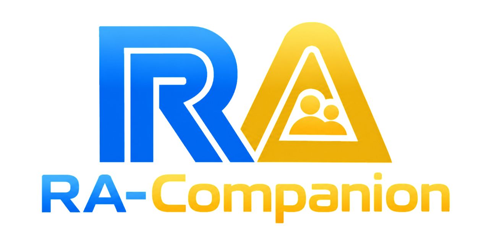
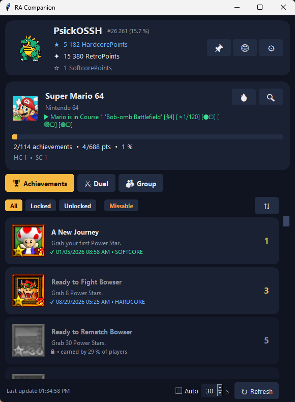
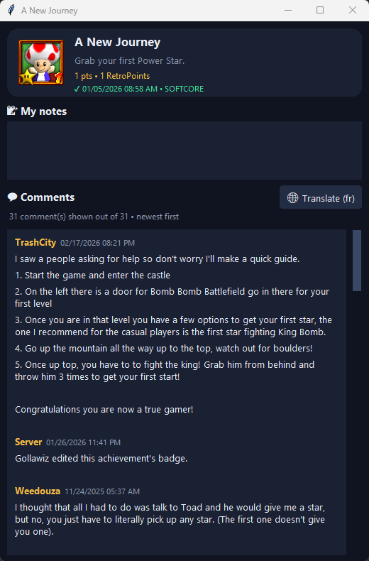
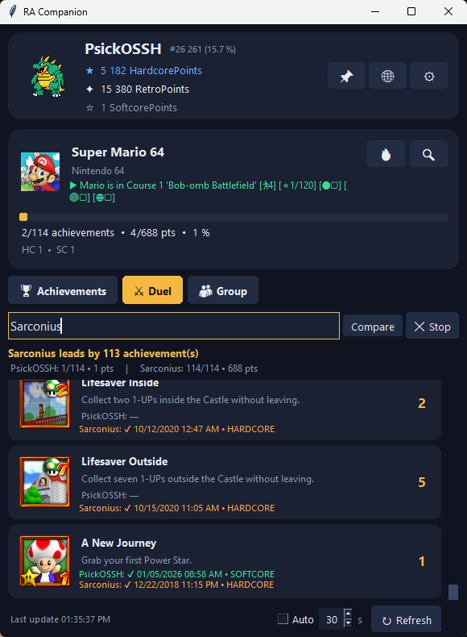
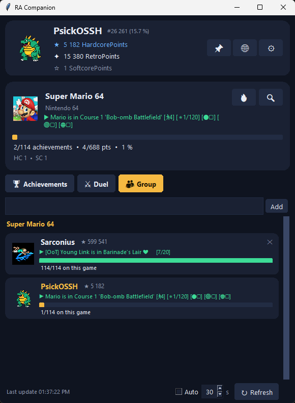
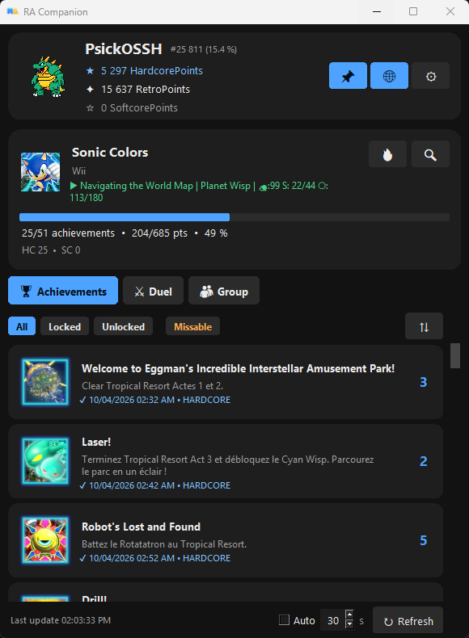

> **AI-assisted project.** The code of this project was written with the help of an AI assistant,
> directed and tested by the author. Expect rough edges and please report any bug you find.

<p align="center">
  
</p>

# RA Companion



| Achievement detail | Duel |
|---|---|
|  |  |

| Group | Skin |
|---|---|
|  |  |

A companion for [RetroAchievements](https://retroachievements.org): keep it open next to your emulator and follow your
progress live. It comes in two versions that look and behave the same way:

- **Windows**: a desktop application (Python + Tkinter, also available as a ready-to-use `.exe`).
- **Android**: a phone application (Python + Kivy, installed from an `.apk`).

## Features

- **Persistent image cache** on Windows and Android: previously downloaded achievement badges and game icons
  are reused after restarting the app, reducing repeated requests to the RetroAchievements media server.

- **Live profile**: hardcore / softcore points, RetroPoints, rank (`#1 234`) and percentile, current game with rich presence
- **Achievement list**: filters *All / Locked / Unlocked* that combine with a **missable** option (`⚠ Missable`),
  11 sort orders, optional hardcore-only counting (`⚡`), HC / SC counters, badges, unlock dates in your language and
  time zone, and the share of players who earned each locked achievement
- **Achievement page**: description, points, unlock date, **personal note** (`✎`) and the community **comments**,
  with one-click **translation** (`🌐`)
- **Personal notes**: saved locally, exported to / imported from a JSON file (the same file works on both versions)
- **Notifications** when you (or your friend) unlock an achievement (can be switched off in the settings; a
  **Send a test notification** button checks that they work, on both versions)
- **Duel**: compare your progress with a friend on the same game, see who is ahead and who unlocked what
- **Group dashboard**: follow several players at once, ranked by progress on the current game
- **Game search** by name (all consoles or a single one) to track any game
- **Automatic refresh** with a configurable interval (`Auto` button + seconds) or manual refresh
- **6 interface languages** (English, Français, Español, Deutsch, Italiano, Português), a separate **translation
  language**, and **skins** (default, dark and light are included; a skin file works on both versions)
- **Update check** in the settings: looks for a newer `.exe` (Windows) or `.apk` (Android) in the GitHub releases

## Install

Download the file of your platform from the [latest release](../../releases/latest).

### Windows

1. Download `RA-Companion.exe` from the **Assets** list and double-click it. Nothing has to be installed.
2. Windows may show a *"Windows protected your PC"* (SmartScreen) warning because the executable is not signed:
   click **More info**, then **Run anyway**.
3. On first launch the settings window opens: enter your RetroAchievements username and your Web API key
   (<https://retroachievements.org/settings?tab=applications>).

### Android

1. Download the `.apk` from the release on your phone and open it.
2. Android asks once to allow installing apps from this source (your browser or file manager): accept.
3. Open the app, then **Settings**: enter your username and Web API key.
4. Android 13 and later asks for the permission to show notifications: accept it to be notified of new achievements.

An update is installed over the previous version only if the `.apk` was signed with the same key.

### From the source code

```
python ra_companion.py
```

Needs Python 3.9 or newer with Tkinter (included in the official Windows installer). No third-party package is required.

To try the Android interface on a PC: `pip install kivy certifi`, then `python main.py` (Kivy 2.1 or newer).

## Project layout

Both versions live in the same repository and share the API, skins and update code.

| Windows only | Android only | Shared |
|---|---|---|
| `ra_companion.py` entry point | `main.py` + `main.kv` screens | `ra_api.py` RetroAchievements Web API |
| `app.py` window and logic | `features.py` logic, notes, duel, group | `utils.py` formatting, sorting |
| `widgets.py` rounded widgets | `storage.py`, `themes.py` | `config.py` paths and constants |
| `desktop_texts.py` texts | `uitext.py`, `mobile_i18n.py` texts | `i18n.py` translations |
| `notes_io.py` notes export / import | `notify.py`, `androidutil.py` system access | `translator.py` translation |
| `build-exe.bat`, `docs/logo.ico` | `layoututil.py`, `buildozer.spec`, `docs/icon.png`, `fonts/` | `updater.py`, `appinfo.py` update check, version |
| | | `imgcache.py` persistent image cache |
| | | `skins/` visual themes |

Other folders: `docs/` (logo and screenshots of this README), `tests/` (unit tests of the logic).

`skins/__init__.py` must stay inside the `skins` folder, next to the skin files.

In `app.py`, the sizes of the Windows windows and buttons are constants gathered just before `class App`
(`MAIN_WINDOW`, `SETTINGS_WINDOW`, `TAB_BTN`, `FILTER_BTN`, `ICON_BTN`, `SETTINGS_BTN`, `SAVE_BTN`).

## Tests

```
python -m unittest discover -s tests
```

## Building

### Windows `.exe`

Install [PyInstaller](https://pyinstaller.org) (`pip install pyinstaller`), then run `build-exe.bat` from the project
folder. The executable is created in `dist\RA-Companion.exe`.

The skins are loaded by name, so PyInstaller needs them listed explicitly (`--hidden-import skins.<name>` and
`--add-data "skins;skins"`). If you add a skin, add it to the build script too.

### Android: prepare the build environment (once)

The `.apk` is built with [Buildozer](https://buildozer.readthedocs.io) and python-for-android. They need Linux
(Ubuntu is the tested distribution), or **Windows with WSL2 + Ubuntu**. Everything below runs in the Linux terminal.

**1. System packages** (build tools, Java 17, libraries):

```bash
sudo apt update
sudo apt upgrade -y
sudo apt install -y git zip unzip openjdk-17-jdk python3-pip python3-virtualenv \
    autoconf libtool pkg-config zlib1g-dev libncurses5-dev libncursesw5-dev libtinfo6 \
    cmake libffi-dev libssl-dev automake autopoint gettext build-essential ccache curl
```

This is the list of the Buildozer documentation plus a few common build tools. If a build stops on a missing header
(`*.h` file), install the matching `-dev` package (for example `libsqlite3-dev`, `libbz2-dev`, `liblzma-dev`).
On Ubuntu 22.04 and older the package `libtinfo5` replaces `libtinfo6`.

**2. Make Java 17 the default** (only if several Java versions are installed):

```bash
sudo update-alternatives --config java
sudo update-alternatives --config javac
```

**3. Install Buildozer.** `pipx` keeps its Python dependencies isolated:

```bash
sudo apt install -y pipx
pipx ensurepath
# close and reopen the terminal, then:
pipx install buildozer
```

**4. Python version and python-for-android branch.** A recent Ubuntu ships Python 3.14. With it, the stable
python-for-android (`master`) fails while it creates its virtual environment
(`ImportError: cannot import name 'BuildDependencyInstallError'`, a `pip` inconsistency reported in
[python-for-android issue #3364](https://github.com/kivy/python-for-android/issues/3364)). This project builds with
**Python 3.14** by using the `develop` branch of python-for-android and the NDK 28c: set both in `buildozer.spec`
(see *Points of `buildozer.spec`* below). Nothing else has to be installed.

An alternative is an older Python (3.12, from the `deadsnakes` PPA, then `pipx install --force --python python3.12
buildozer`). It was not tested for this project.

Avoid editing `pythonforandroid/build.py` by hand: the change is lost at the next update of Buildozer.

**5. Work in the Linux file system.** Copy or clone the project in your Linux home (`~/RA-Companion`), preferably **not**
under `/mnt/c/...`. A build on the Windows drive can work, but it is slower and can fail on file permissions.

### Android `.apk`

From the project folder:

```bash
buildozer -v android debug
```

The first build downloads the Android SDK, the NDK and the other components by itself (several GB, it can take a long
time); the next builds are much faster. The `.apk` is created in `bin/`.

Points of `buildozer.spec` that matter:

- `p4a.branch = develop` is needed with Python 3.14 (see step 4)
- `android.ndk = 28c` is the NDK recommended by python-for-android; an older one (for example `25b`) makes the
  build fail in the `libthorvg` recipe (`IndexError: list index out of range`)
- `android.api = 33`; `android.sdk` is deprecated and ignored, do not set it
- `source.include_exts` must contain `ttf` (the app font), `kv` and `png`
- `android.permissions = INTERNET,POST_NOTIFICATIONS`
- `android.accept_sdk_license = True` avoids the license question during the first build
- `version.regex` / `version.filename` read the version from `appinfo.py`
- `source.exclude_patterns` / `source.exclude_dirs` should leave out the Windows files, `tests`, `docs`, `bin`, `dist`, `build`
- `icon.filename` points to `docs/icon.png` (512 x 512)

`develop` is a moving branch. Once a build works, you can pin it: read the commit with
`git -C .buildozer/android/platform/python-for-android rev-parse --short HEAD` and set `p4a.commit = <hash>`.

Useful commands:

| Command | Use |
|---|---|
| `buildozer android clean` | clean the build of the app (after a change of requirements, or when a build is stuck) |
| `adb install -r bin/*.apk` | install the `.apk` on a phone connected by USB (USB debugging enabled) |
| `adb logcat -s python` | read the Python messages and errors of the app on the phone |

**The two `.buildozer` folders.** `~/.buildozer` (in your Linux home) holds the Android SDK, the NDK and the downloads,
shared by all your projects (4 to 5 GB). The `.buildozer/` folder of the project holds the python-for-android checkout
and the build of this app. Deleting the project one is safe: the next build is longer, but nothing is downloaded again.
Delete `~/.buildozer` only if you accept to download everything again, and then also delete `.buildozer/state.db` of the
project. Do not publish either of them.

After changing `android.ndk` or `p4a.branch`, delete the `.buildozer/` folder of the project before building again.

Keep the signing key: without it, a new `.apk` cannot replace the installed one.

## Publishing a release

1. Change `__version__` in `appinfo.py` (for example `1.0.1`; `1.0` and `1.0.0` are the same version).
2. Build the `.exe` and the `.apk`.
3. Create a GitHub release whose tag is the new version (`v1.0.1`) and attach both files.

The in-app update check compares the installed version with the newest release that contains a file of its kind.
`UPDATE_REPO` in `appinfo.py` is the repository it looks at (it must be public).

## Creating a skin

1. Copy `skins/default.py` to `skins/my_skin.py` (any name not starting with an underscore).
2. Change `NAME` and any color / font / corner radius. Variables you remove fall back to the default skin,
   so a skin can override just a few values.
3. Open **Settings -> Skin** and select it (Windows restarts to apply it).

Every variable is documented in `skins/default.py`. When you add a skin variable to the code, also add it to
`default.py` so that other skins keep working.

## Adding a UI language

- **Windows**: in `i18n.py`, copy the `"en"` block of `I18N`, translate the values, add the language to `UI_LANGS`,
  `REFRESH_LABELS` and `SORT_LABELS`, then add its texts to `desktop_texts.py`. Date formats are in `utils.py`.
- **Android**: add the language to `mobile_i18n.py` and to the tables of `uitext.py`, then run the tests:
  `tests/test_i18n.py` lists every text that is still missing.

## Data, privacy and network

- Your settings (including the **API key**, stored as plain text) and personal notes are saved on your device only:
  in your home directory as `.ra_companion*.json` on Windows, in the private folder of the app on Android.
  Never publish these files.
- **Image cache:** achievement badges (colored and locked versions), game icons and avatars are saved on disk,
  not just in memory. Previously downloaded badges and game icons are reused across app restarts.
  Images are cached separately by URL, so the colored and locked badge versions each have their own file.
  The cache is stored in `.ra_companion_cache/img/` in your home directory on Windows and in `img_cache/`
  inside the app's private data folder on Android.
- The current cache policy keeps badges (`/Badge/`) and game images (`/Images/`) without automatic expiry.
  Other images handled by this cache, including avatars, expire after seven days and are refreshed when requested.
  Windows settings logos still use their separate existing disk cache; Android settings logos use the shared image cache.
  There is currently no automatic size limit or eviction for old badge files.
- The image cache does **not** make the whole app available offline: profile and achievement data still need the API.
- Network access: the RetroAchievements API and media server (profile, games, badges, comments), the GitHub API
  (update check, only when you press the button), and the translation services (only when translation is enabled:
  the translated texts are sent to Google Translate, with MyMemory as a fallback).
  Existing cached images are reused according to the policy above instead of downloaded at every launch.
- The game list of each console is downloaded once and kept for 30 days.

## Troubleshooting

- **A badge or game icon stays outdated:** badges and game icons have no automatic cache expiry. Close the app and
  remove the affected image file from the image cache, or clear the image cache folder to download its contents again.
  Do not delete settings or notes, and do not use Android's *Clear storage / Clear data* just to refresh images.

- **SmartScreen blocks the exe:** click *More info*, then *Run anyway* (the exe is not code-signed).
- **Antivirus flags the exe:** single-file PyInstaller executables are sometimes reported as false positives.
  Run from source or build the exe yourself.
- **Crossed boxes instead of symbols on Android:** `ttf` is missing from `source.include_exts` in `buildozer.spec`.
- **No notifications:** on Android check the permission in the Android settings. On both versions use the *Send a test
  notification* button of the settings. The phone may freeze the app after a few minutes in the background, so
  notifications can be delayed while the screen is off.
- **Translation unavailable:** the message in the status bar names the cause (for example `HTTP 429`: the service
  limits the requests, retry a minute later by pressing the translation button again).
- **The update does not install:** the `.apk` must be signed with the same key as the installed one.
- **The Android build fails while creating its virtual environment** (`BuildDependencyInstallError`, `pip`,
  Python 3.14): set `p4a.branch = develop` in `buildozer.spec` and delete the project `.buildozer/` folder.
- **The Android build fails in `libthorvg` with `IndexError: list index out of range`:** the NDK is too old. Set
  `android.ndk = 28c` and delete the project `.buildozer/` folder.
- **`Requested API target 33 is not available` after deleting `~/.buildozer`:** the project's `.buildozer/state.db` still
  says the SDK packages are installed. Delete `.buildozer/state.db` of the project (or the whole project `.buildozer`)
  and build again.
- **The Android build is very slow or fails on permissions:** the project is on `/mnt/c/...`; move it to the Linux home.
- `cannot import name 'active' from 'skins'`: the `skins` folder has no `__init__.py`; put it back next to
  `default.py`.
- Nothing is displayed: check your username and Web API key in the settings.

## Third-party components

The Android app embeds the [DejaVu Sans](https://dejavu-fonts.github.io/) font (free license, see `fonts/LICENSE_DEJAVU`),
extended with a few drawn symbols.

## License

Released under the [MIT License](LICENSE).

## Credits

Data and badges come from [RetroAchievements](https://retroachievements.org). This project is not affiliated with
RetroAchievements.
