<p align="center">
  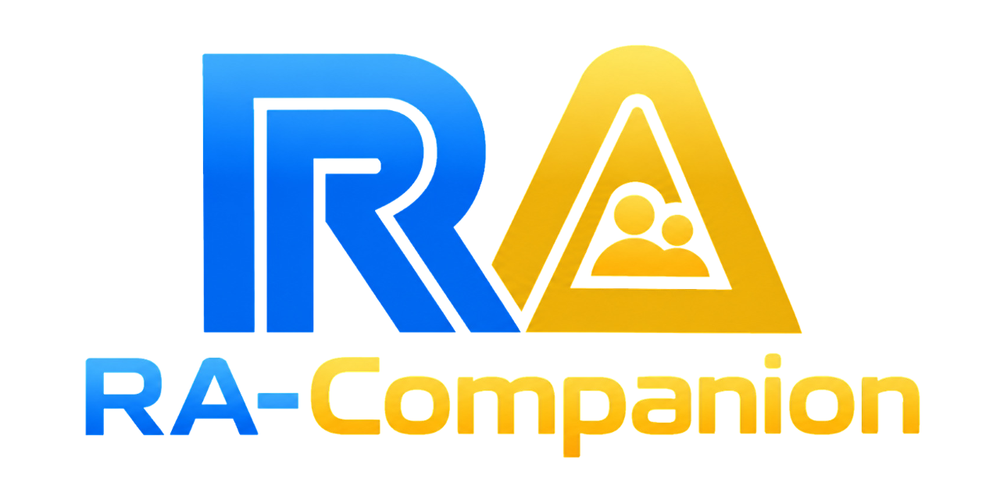
</p>

# RA Companion

> **AI-assisted project.** The code of this project was written with the help of an AI assistant,
> directed and tested by the author. Expect rough edges and please report any bug you find.

[](https://github.com/PsickOSSH/RA-Companion/releases)


<p align="center">
  <a href="https://buymeacoffee.com/psickossh"></a>
</p>

## Screenshots

<details>
<summary><b><picture></picture> Main window</b> (click to show)</summary>
<br>

<table>
  <tr>
    <td align="center" valign="top"><b>Achievements</b><br>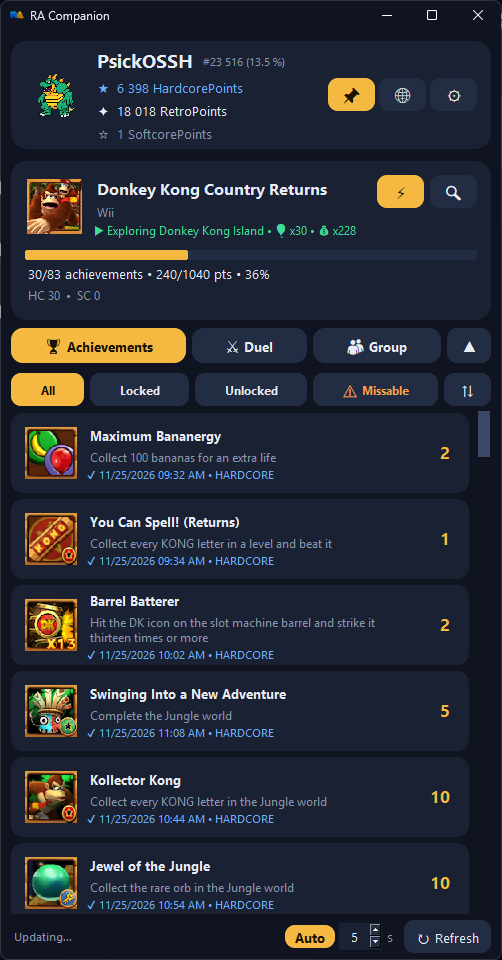</td>
    <td align="center" valign="top"><b>Folded header</b><br>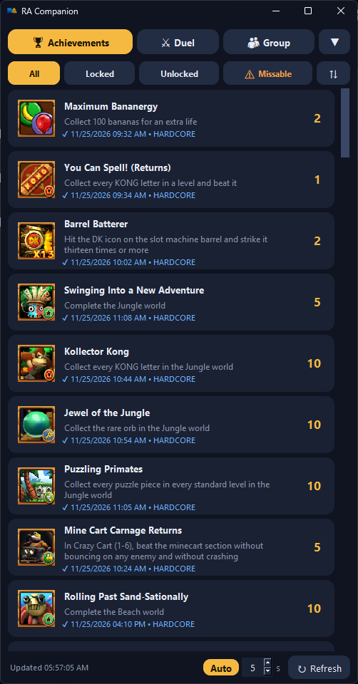</td>
  </tr>
</table>

</details>

<details>
<summary><b><picture></picture> Horizontal interface</b> (click to show)</summary>
<br>

<p align="center">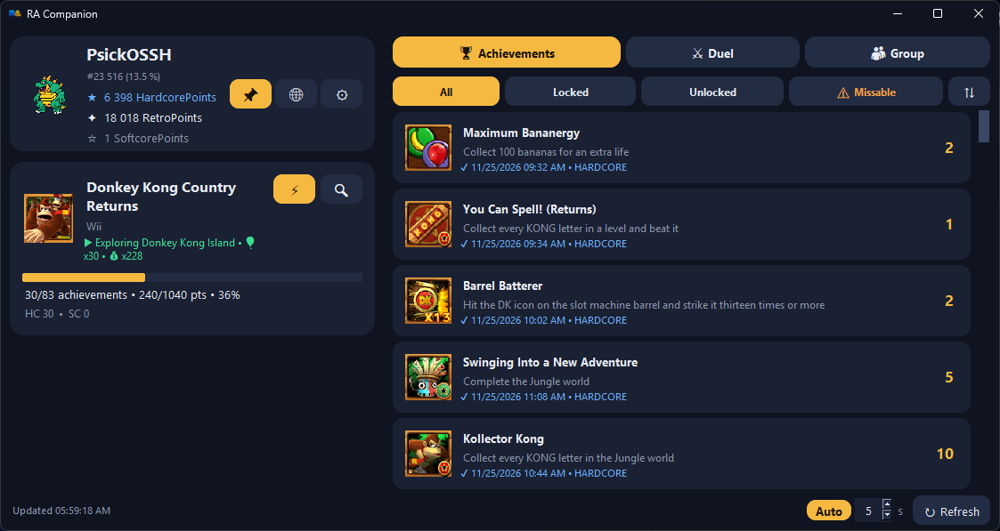</p>

</details>

<details>
<summary><b><picture></picture> Achievement page, duel and group</b> (click to show)</summary>
<br>

<table>
  <tr>
    <td align="center" valign="top"><b>Achievement page</b><br>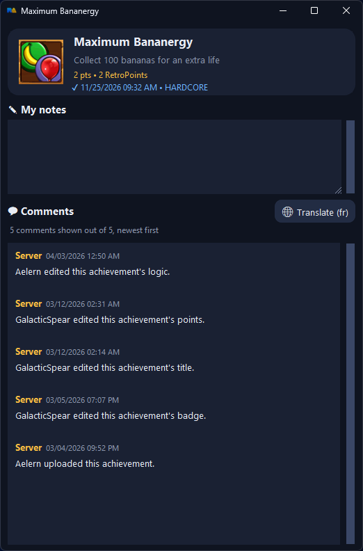</td>
    <td align="center" valign="top"><b>Duel</b><br>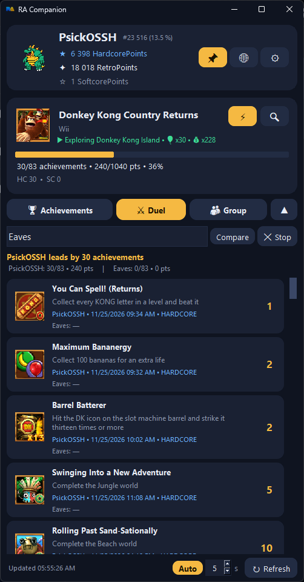</td>
    <td align="center" valign="top"><b>Group</b><br>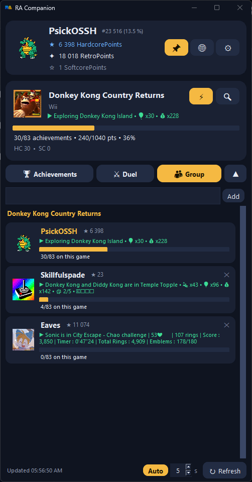</td>
  </tr>
</table>

</details>

<details>
<summary><b><picture></picture> Themes</b> (click to show)</summary>
<br>

<table>
  <tr>
    <td align="center" valign="top"><b>Dark (Graphite)</b><br>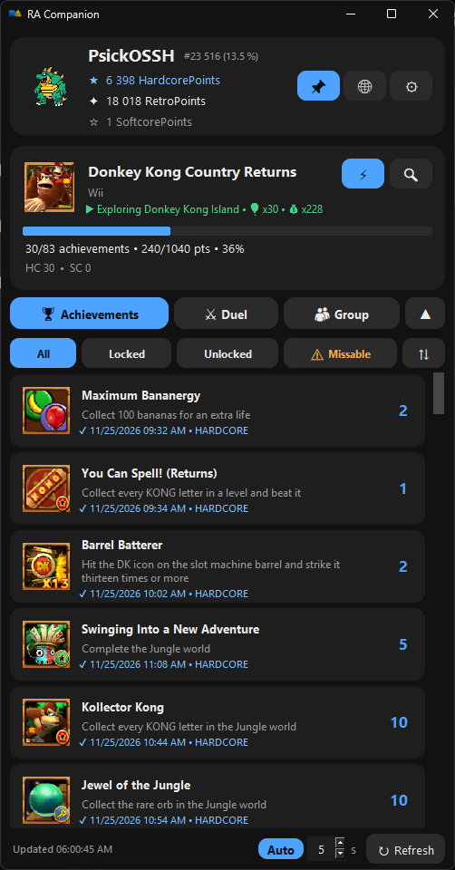</td>
    <td align="center" valign="top"><b>Light (Daylight)</b><br>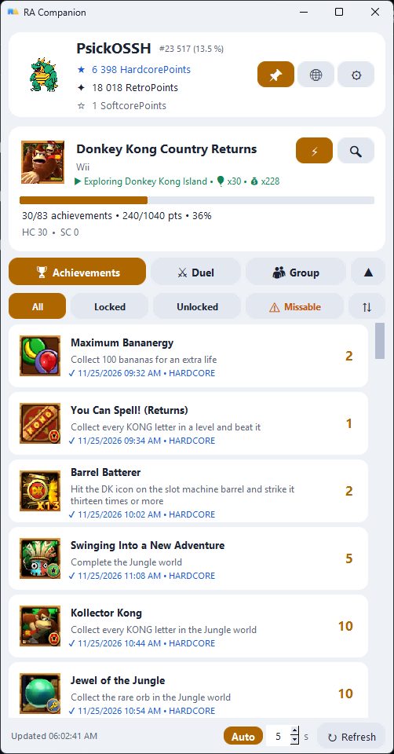</td>
    <td align="center" valign="top"><b>Light (Paper Indigo)</b><br>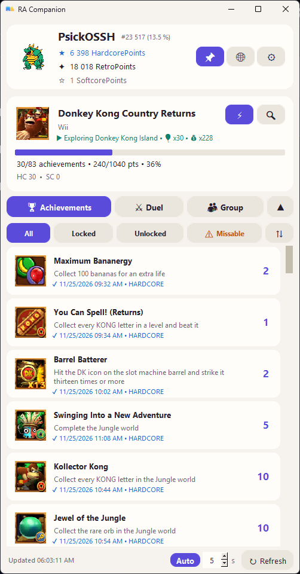</td>
    <td align="center" valign="top"><b>Dream Land (Kirby)</b><br>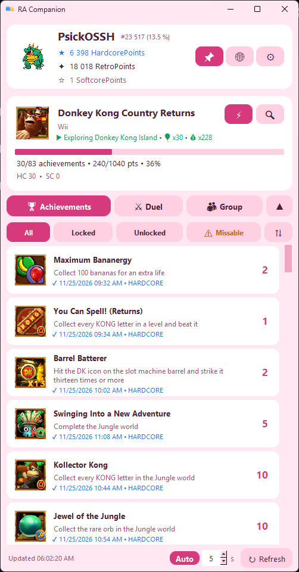</td>
  </tr>
  <tr>
    <td align="center" valign="top"><b>Mushroom Kingdom (Mario)</b><br>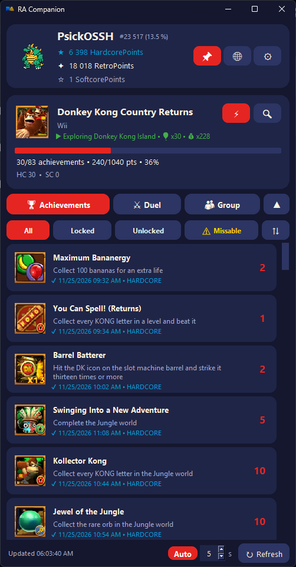</td>
    <td align="center" valign="top"><b>Hyrule (Zelda)</b><br>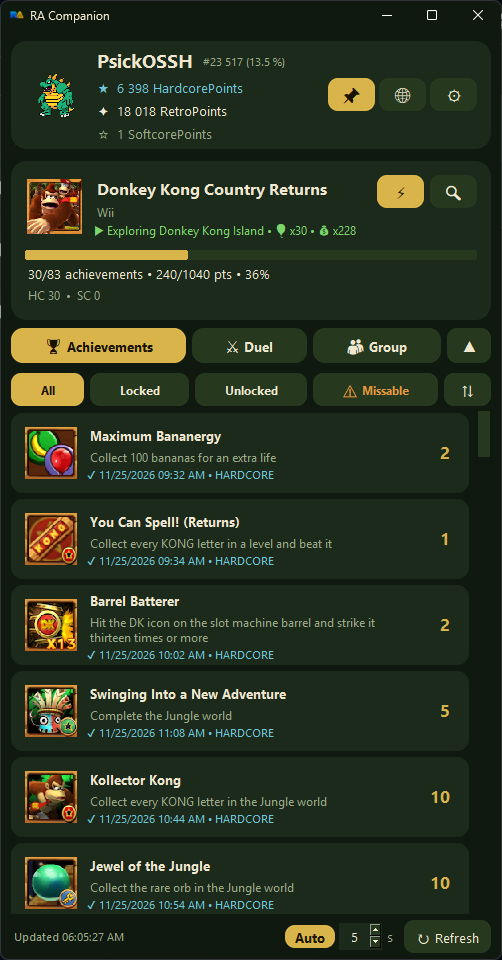</td>
    <td align="center" valign="top"><b>Kanto (Pokémon)</b><br>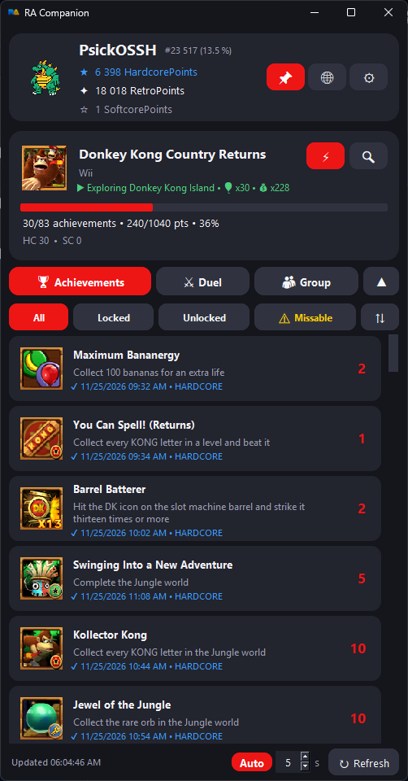</td>
    <td align="center" valign="top"><b>Green Hill (Sonic)</b><br>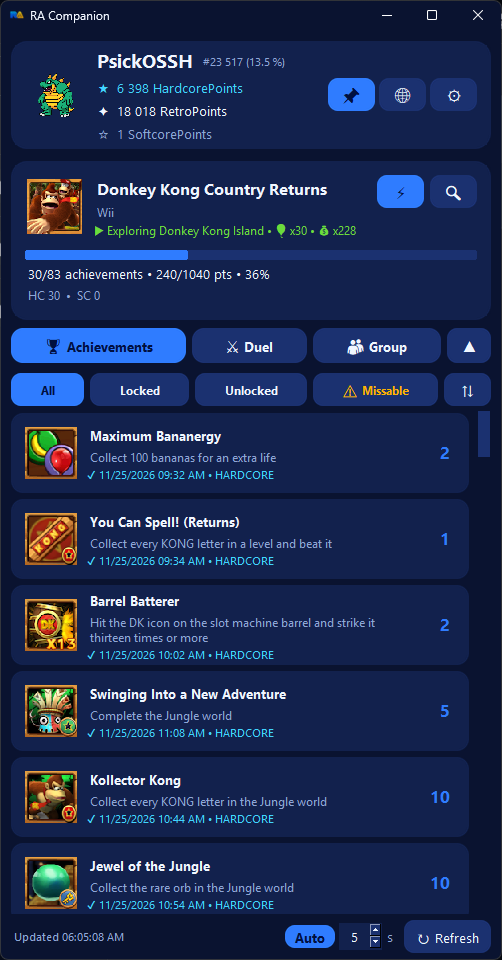</td>
  </tr>
  <tr>
    <td align="center" valign="top"><b>Zebes (Metroid)</b><br>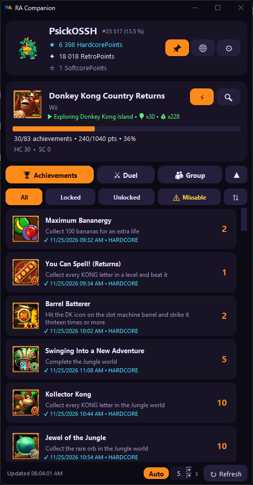</td>
    <td align="center" valign="top"><b>Spartan (Halo)</b><br>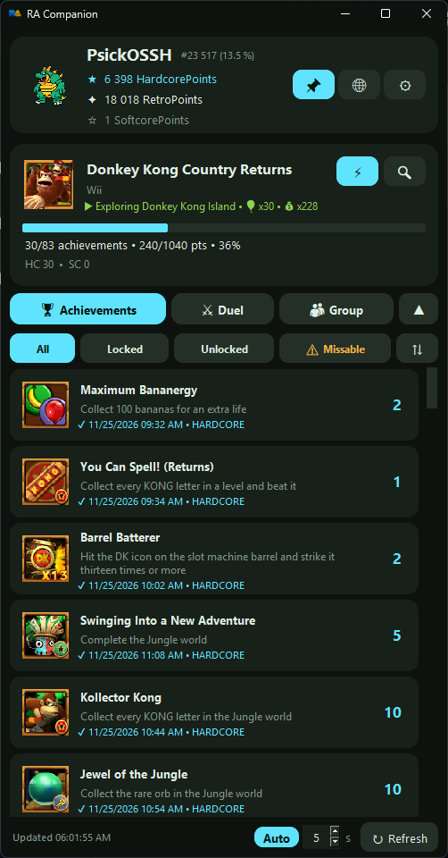</td>
    <td align="center" valign="top"><b>Hell (Doom)</b><br>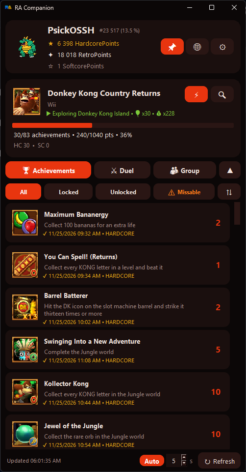</td>
    <td align="center" valign="top"><b>Overworld (Minecraft)</b><br>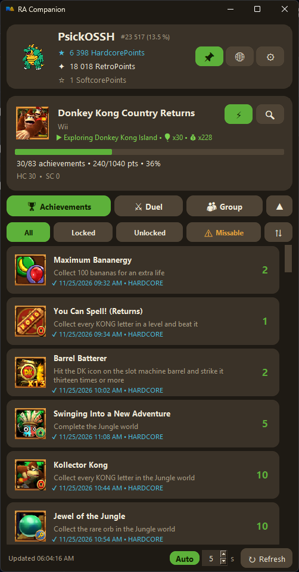</td>
  </tr>
</table>

The default theme (Midnight Gold) is the one of the other screenshots.

</details>

## About

A companion for [RetroAchievements](https://retroachievements.org): keep it open next to your emulator and follow your
progress live. It comes in three versions that look and behave the same way:

- **Windows**: a desktop application (Python + Tkinter, also available as a ready-to-use `.exe`).
- **Android**: a phone application (Python + Kivy, installed from an `.apk`).
- **iOS**: the same Kivy interface, built with [kivy-ios](https://github.com/kivy/kivy-ios) and Xcode
  (see *Building for iOS* below).

## Features

- **Persistent image cache** on Windows, Android and iOS: previously downloaded achievement badges and game icons
  are reused after restarting the app, reducing repeated requests to the RetroAchievements media server.

- **Live profile**: hardcore / softcore points, RetroPoints, rank (`#1 234`) and percentile, current game with rich presence
- **Time to 100%**: the game card shows the average time needed to master the current game (the median of the hardcore
  players, from RetroAchievements); the line is hidden when the game has no value
- **Session summary**: the game card counts the achievements and points unlocked since the app was opened, with the time
  elapsed; click / tap the line to list them. Only the games followed by the app are counted
- **Clickable pictures**: your avatar, the game picture and the badge of the achievement page open the matching page on
  retroachievements.org. On Windows and Linux a frame and a tooltip appear under the mouse; on a phone the picture is
  dimmed while pressed
- **Achievement list**: filters *All / Locked / Unlocked* that combine with a **missable** option ( *Missable*),
  11 sort orders, optional hardcore-only counting (), HC / SC counters, badges, unlock dates in your language and
  time zone, and the share of players who earned each locked achievement
- **Achievement page**: description, points, unlock date, **personal note** () and the community **comments**,
  with one-click **translation** () through several services: if one stops working, the next one takes over
  (free Google and MyMemory by default; **DeepL**, **LibreTranslate** and an **AI model** (Gemini, Groq, Mistral,
  OpenRouter, Ollama...) once you enter a key / server address in the settings, and you choose the **order** in which the
  services are tried (arrows in the settings). Translations are cached on disk, a
  service that just failed is skipped for a while, and a text that failed is retried automatically. **Web links** in
  the comments are highlighted (colour + underline) and open in the browser when clicked / tapped
- **Personal notes**: saved locally, exported to / imported from a JSON file (the same file works on all versions), and
  deleted from the settings: choose one, several or all of them in the list. On iPhone, the export copies the notes to
  the clipboard; to import, copy the content of a notes file first (the same text as the file of the other versions).
  On Windows, the note area of an achievement can be enlarged by dragging the handle in its bottom-right corner (its
  height is remembered); a longer text scrolls
- **Copy / paste in the text fields**: on Windows, a right click in a field (settings, notes, comments) opens a
  *Cut / Copy / Paste / Select all* menu; on Android and iOS, a long press on a field shows a *Cut / Copy / Paste* bar
- **Horizontal interface** (Windows): when the window is made wide (about 760 px and more, clearly wider than tall), the
  profile and the game card move to a left column and the tabs and lists to the right; it goes back to the vertical
  layout when the window is narrow again
- **Fold the header**: a button at the end of the tabs ( / ) hides the profile and game cards to leave all the room to
  the list, and shows them again (Windows and mobile, vertical layout; in the horizontal layout the cards are always shown)
- **Window position remembered** (Windows): the main window reopens where and at the size you closed it; if that screen
  is no longer connected, it opens at its default place
- **Notifications** when you (or your friend) unlock an achievement (can be switched off in the settings; a
  **Send a test notification** button checks that they work, on all versions)
- **Duel**: compare your progress with a friend on the same game, see who is ahead and who unlocked what
- **Group dashboard**: follow several players at once, ranked by progress on the current game
- **Fast long lists**: the achievement and duel lists only build the rows as they are scrolled into view, so a game with
  hundreds of achievements shows up at once (all versions)
- **Game search** by name (all consoles or a single one) to track any game, with two more tabs, **Recent** (your
  recently played games) and **Want to Play** (your list from the website), each with its own search field (name or console)
- **OBS overlay** (Windows and Linux, off by default) for streams and recordings: it shows the progress on the current
  game, the last unlocked achievement and a banner at each new one. Tick **OBS overlay** in the settings and save, click
  **Copy the address** (`http://127.0.0.1:8765`), then add a **Browser** source with that address in OBS (460 x 240).
  **Send a test notification** also shows it in OBS, to place the overlay. New achievements appear at the next refresh
  of the app, which must stay open. If the port is already used, set another `overlay_port` in `.ra_companion.json`
- **Automatic refresh** with a configurable interval (`Auto` button + seconds, from 5 s to 1 hour) or manual refresh.
  On Windows, a **global keyboard shortcut** also refreshes, even while an emulator has the focus (`Ctrl+Alt+R` by
  default; change it in the settings: click the field, then press `F1`-`F12` or `Ctrl`/`Alt` + a letter or digit;
  `Backspace` restores the default). Windows keeps the shortcut for RA Companion, so choose one your emulator does not
  use (for example Dolphin uses `F1`-`F8`); if it is already taken by another program, a message is shown
- **6 interface languages** (English, Français, Español, Deutsch, Italiano, Português), a separate **translation
  language**, and **skins** (default, dark, light and several game themes such as Kirby, Zelda or Mario are included;
  they all share the shapes of the default skin and differ by their colors; a skin file works on all versions)
- **Settings file**: export every setting (account, keys, languages, refresh, translation, friends...) and import it on
  another device or after a new installation, on all versions. The skin, the window position, the imported skins and the
  notes are not in it (skins and notes have their own export). The **Delete** button of the same line puts the settings
  back to their default values, either everything or keeping only the username and the API key. **The file contains your
  API keys in plain text: do not share it.** On iPhone the export copies to the clipboard; to import, copy the content of
  the file first
- **Complete backup**: the **Everything** line of the settings exports one file with the settings, the theme, the
  imported skins and the notes, and imports it on another device or after a new installation (all versions). The import
  replaces the settings and the theme, adds the skins (same name: replaced) and merges the notes, after a confirmation.
  **The file contains your API keys in plain text: do not share it.** The **Delete** button of the same line resets all the
  settings (account included) and the theme, and deletes the imported skins and the notes, after a confirmation. On
  iPhone it goes through the clipboard, like the settings file.
- **Your own skins**: import a skin file in the settings, without rebuilding the app, then export or delete the imported
  skins, one or several at a time (all versions; see [Creating a skin](#creating-a-skin))
- **Themed title bar** (Windows): the title bar of every window takes the background and text colors of the skin on
  Windows 11; on Windows 10 it is only dark or light, according to the skin
- **Update check** in the settings: looks for a newer `.exe` (Windows), `.apk` (Android) or `.ipa` (iOS) in the GitHub releases
- **iOS support** (experimental): safe-area margins for the notch and home indicator, native clipboard (the *Cut / Copy / Paste* bar) and automatic detection of the device language
- **In-app unlock banner** (Android and iOS): when the app is open, a new achievement shows a banner with its badge, title, description, points and a gold outline for your unlocks or a blue one for a friend's; up to 4 banners are stacked, a tap dismisses them, and the height adapts to the text
- **System notifications** (Android and iOS): when the app has just been sent to the background, unlocks are shown as system notifications instead

## Install

Download the file of your platform from the [latest release](../../releases/latest).

### Windows

1. Download `RA-Companion.exe` from the **Assets** list and double-click it. Nothing has to be installed.
2. Windows may show a *"Windows protected your PC"* (SmartScreen) warning because the executable is not signed:
   click **More info**, then **Run anyway**.
3. On first launch the settings window opens: enter your RetroAchievements username and your Web API key
   (<https://retroachievements.org/settings?tab=applications>).

### Linux (AppImage)

1. Download `RA-Companion-<version>-x86_64.AppImage` from the **Assets** list, make it executable (`chmod +x`) and run it.
2. To build it yourself (Ubuntu / WSL): `sudo apt install python3-tk python3-venv`, create a virtual environment with
   `pip install pyinstaller pillow`, then run `./build-linux.sh`; the file is written to `dist-linux/`.
3. Not available on Linux: the global refresh shortcut (it still works while the window has the focus).
4. The AppImage needs a glibc at least as recent as the one of the machine that built it. The release file is built
   by the *Build Linux AppImage* GitHub workflow on Ubuntu 22.04, so it runs on Debian 12 and later, Ubuntu 22.04 and later,
   Fedora, Mint... If you build it yourself on a very recent system and get `GLIBC_x.y not found` elsewhere, build on an
   older one. On Debian / Ubuntu the AppImage also needs `libfuse2` (`libfuse2t64` on Debian 13 / Ubuntu 24.04).
5. Without the AppImage: `sudo apt install python3-tk`, then `python3 ra_companion.py` from the project folder.
6. Linux details: the emoji are drawn with a bundled monochrome font (colour emoji fonts are ignored), the program does
   not use the input method of the desktop (IBus, Fcitx: it made the lists very slow; the keyboard, dead keys and Compose
   still work), and "always on top" only works if your window manager supports it (a message tells you when it does not).
   Environment variables, for problems: `RA_KEEP_IM=1` keeps the input method (for CJK input), `RA_NO_EMOJI_FONT=1` does not
   load the emoji font, `RA_NO_SMOOTH=1` draws plain rounded corners, `RA_PROFILE=1` prints in the terminal how long the
   first rows of the achievement list take to be built, laid out and painted.

### Android

1. Download the `.apk` from the release on your phone and open it.
2. Android asks once to allow installing apps from this source (your browser or file manager): accept.
3. Open the app, then **Settings**: enter your username and Web API key.
4. Android 13 and later asks for the permission to show notifications: accept it to be notified of new achievements.

An update is installed over the previous version only if the `.apk` was signed with the same key.

### iOS

The iOS version is not distributed through the App Store.

#### Option A: Sideloading source (Recommended - SideStore, AltStore Classic, Feather)
You can add the project repository source directly to your sideloading app to install and receive one-tap updates:

1. Copy the source URL: https://raw.githubusercontent.com/PsickOSSH/RA-Companion/main/apps.json
2. Open **SideStore** or **AltStore Classic**, go to **Sources**, tap **+** (Add Source), and paste the URL.
3. Find **RA Companion** in the list and tap **INSTALL** (or **UPDATE** when a new release is available).

#### Option B: Manual IPA installation
Download the unsigned `.ipa` from the latest GitHub release, transfer it to your iPhone, and import it using the `+` button in AltStore Classic or SideStore.

#### Option C: Build from source
Build it from source using a Mac with Xcode and `kivy-ios` (see [Building for iOS](#ios) below).

> **Note:** When using a free Apple ID, the developer certificate signature expires after 7 days and the app must be refreshed periodically from SideStore or AltStore. AltStore PAL (EU DMA version) is not supported as it requires Apple-notarized marketplace distribution.

### From the source code

```
python ra_companion.py
```

Needs Python 3.9 or newer with Tkinter (included in the official Windows installer). No third-party package is required. `pip install pillow` is optional: with it the rounded buttons and cards get smooth corners and the banner of the OBS overlay gets its trophy icon (the `.exe` already includes it).

To try the Android / iOS interface on a PC: `pip install kivy certifi`, then `python main.py` (Kivy 2.1 or newer).

## Project layout

All versions live in the same repository and share the API, skins and update code. Android and iOS use the same
Kivy interface; only a few files are specific to one of them.

| Windows only | Android and iOS (Kivy) | Android only | iOS only | Shared |
|---|---|---|---|---|
| `ra_companion.py` entry point | `main.py` + `main.kv` screens | `androidutil.py` system access (files, links) | `iosutil.py` safe areas, device language, clipboard | `ra_api.py` RetroAchievements Web API |
| `app.py` window and logic | `features.py` logic, notes, duel, group | `buildozer.spec` APK build settings | | `utils.py` formatting, sorting, hardcore median helpers |
| `widgets.py` rounded widgets | `storage.py`, `themes.py` | `docs/icon.png` app icon | | `config.py` paths and constants |
| `desktop_texts.py` texts | `uitext.py`, `mobile_i18n.py` texts | | | `i18n.py` translations |
| | `notify.py` notifications (Android and iOS code paths) | | | `translator.py` translation |
| `build-exe.bat`, `docs/logo.ico` | `layoututil.py`, `fonts/` | | | `updater.py`, `appinfo.py` update check, version |
| `overlay.py` OBS overlay (also Linux) | | | | |
| | | | | `imgcache.py` persistent image cache |
| | | | | `medians.py` hardcore median unlock and mastery times (cached for a day) |
| | | | | `skins/` visual themes |
| | | | | `userskins.py` skins imported by the user |
| | | | | `settings_io.py` settings export / import |
| | | | | `notes_io.py` notes export / import / list |
| | | | | `backup_io.py` complete backup |

The iOS app is built outside the repository with kivy-ios and Xcode (see *Building → iOS*), from a copy of the
Kivy files listed above.

Other folders: `docs/` (logo, screenshots and Buy Me a Coffee images of this README, plus `embed_icon.py`), `tests/` (unit tests of the logic).

`skins/__init__.py` must stay inside the `skins` folder, next to the skin files.

In `app.py`, the sizes of the Windows windows and buttons are constants gathered just before `class App`
(`MAIN_WINDOW`, `SETTINGS_WINDOW`, `TAB_BTN`, `FILTER_BTN`, `ICON_BTN`, `SETTINGS_BTN`, `SAVE_BTN`).

## Tests

```
python -m unittest discover -s tests
```

The tests cover the logic (API retries, features, translations, image cache, notes, updates...) but not the Tkinter and
Kivy screens, which have to be tried by hand.

## Building

### Windows `.exe`

Install [PyInstaller](https://pyinstaller.org) (`pip install pyinstaller`), then run `build-exe.bat` from the project
folder. The executable is created in `dist\RA-Companion.exe`.

The skins are loaded by name, so PyInstaller needs them listed explicitly (`--hidden-import skins.<name>` and
`--add-data "skins;skins"`). `build-exe.bat` already lists all the skins of the repository. If you add a skin, add a
matching `--hidden-import skins.<name>` to the build script too, otherwise it may be missing from the `.exe`.

### Android: prepare the build environment (once)

The `.apk` is built with [Buildozer](https://buildozer.readthedocs.io) and python-for-android. They need Linux
(Ubuntu is the tested distribution), or **Windows with WSL2 + Ubuntu**. Everything below runs in the Linux terminal.

**1. System packages** (build tools, Java 17, libraries):

```bash
sudo apt update
sudo apt upgrade -y
sudo apt install -y git zip unzip openjdk-17-jdk python3-pip python3-virtualenv \
    autoconf libtool pkg-config zlib1g-dev libncurses5-dev libncursesw5-dev libtinfo6 \
    cmake libffi-dev libssl-dev automake autopoint gettext build-essential ccache curl
```

This is the list of the Buildozer documentation plus a few common build tools. If a build stops on a missing header
(`*.h` file), install the matching `-dev` package (for example `libsqlite3-dev`, `libbz2-dev`, `liblzma-dev`).
On Ubuntu 22.04 and older the package `libtinfo5` replaces `libtinfo6`.

**2. Make Java 17 the default** (only if several Java versions are installed):

```bash
sudo update-alternatives --config java
sudo update-alternatives --config javac
```

**3. Install Buildozer.** `pipx` keeps its Python dependencies isolated:

```bash
sudo apt install -y pipx
pipx ensurepath
# close and reopen the terminal, then:
pipx install buildozer
```

**4. Python version and python-for-android branch.** A recent Ubuntu ships Python 3.14. With it, the stable
python-for-android (`master`) fails while it creates its virtual environment
(`ImportError: cannot import name 'BuildDependencyInstallError'`, a `pip` inconsistency reported in
[python-for-android issue #3364](https://github.com/kivy/python-for-android/issues/3364)). This project builds with
**Python 3.14** by using the `develop` branch of python-for-android and the NDK 28c: set both in `buildozer.spec`
(see *Points of `buildozer.spec`* below). Nothing else has to be installed.

An alternative is an older Python (3.12, from the `deadsnakes` PPA, then `pipx install --force --python python3.12
buildozer`). It was not tested for this project.

Avoid editing `pythonforandroid/build.py` by hand: the change is lost at the next update of Buildozer.

**5. Work in the Linux file system.** Copy or clone the project in your Linux home (`~/RA-Companion`), preferably **not**
under `/mnt/c/...`. A build on the Windows drive can work, but it is slower and can fail on file permissions.

### Android `.apk`

From the project folder:

```bash
buildozer -v android debug
```

The first build downloads the Android SDK, the NDK and the other components by itself (several GB, it can take a long
time); the next builds are much faster. The `.apk` is created in `bin/`.

Points of `buildozer.spec` that matter:

- `p4a.branch = develop` is needed with Python 3.14 (see step 4)
- `android.ndk = 28c` is the NDK recommended by python-for-android; an older one (for example `25b`) makes the
  build fail in the `libthorvg` recipe (`IndexError: list index out of range`)
- `android.api = 33`; `android.sdk` is deprecated and ignored, do not set it
- `source.include_exts` must contain `ttf` (the app font), `kv` and `png`
- `android.permissions = INTERNET,POST_NOTIFICATIONS`
- `android.accept_sdk_license = True` avoids the license question during the first build
- `version.regex` / `version.filename` read the version from `appinfo.py`
- `source.exclude_patterns` / `source.exclude_dirs` should leave out the Windows files, `tests`, `docs`, `bin`, `dist`, `build`
- `icon.filename` points to `docs/icon.png` (512 x 512)

`develop` is a moving branch. Once a build works, you can pin it: read the commit with
`git -C .buildozer/android/platform/python-for-android rev-parse --short HEAD` and set `p4a.commit = <hash>`.

Useful commands:

| Command | Use |
|---|---|
| `buildozer android clean` | clean the build of the app (after a change of requirements, or when a build is stuck) |
| `adb install -r bin/*.apk` | install the `.apk` on a phone connected by USB (USB debugging enabled) |
| `adb logcat -s python` | read the Python messages and errors of the app on the phone |

**The two `.buildozer` folders.** `~/.buildozer` (in your Linux home) holds the Android SDK, the NDK and the downloads,
shared by all your projects (4 to 5 GB). The `.buildozer/` folder of the project holds the python-for-android checkout
and the build of this app. Deleting the project one is safe: the next build is longer, but nothing is downloaded again.
Delete `~/.buildozer` only if you accept to download everything again, and then also delete `.buildozer/state.db` of the
project. Do not publish either of them.

After changing `android.ndk` or `p4a.branch`, delete the `.buildozer/` folder of the project before building again.

Keep the signing key: without it, a new `.apk` cannot replace the installed one.

### iOS

The iOS version is built with [kivy-ios](https://github.com/kivy/kivy-ios) and Xcode. It was tested on an
Intel Mac with macOS Ventura 13.7 and Xcode 15.2, deploying to an iPhone 11.

**1. Requirements (once)**

- Xcode 15.2 or newer, with the iOS platform downloaded (Xcode → Settings → Platforms).
- [MacPorts](https://www.macports.org/install.php) (Homebrew no longer installs on Intel Macs).

```bash
sudo port install autoconf automake libtool pkgconfig
```

**2. Python environment and kivy-ios**

```bash
python3 -m venv ~/kivyios-venv
source ~/kivyios-venv/bin/activate
pip install "Cython==3.0.11" kivy-ios
```

**3. Build the iOS libraries** (in a folder **outside** the project, so `build/` and `dist/` are not
copied into the app):

```bash
mkdir -p ~/kivy-ios-build
cd ~/kivy-ios-build
toolchain build python3 kivy
```

**4. Prepare a clean app folder** (only the files needed by the Kivy interface, without `tests/`, `docs/`
or the Windows files):

```bash
mkdir -p ~/RA-Companion-iOS-app
cd ~/RA-Companion
cp main.py main.kv features.py storage.py themes.py uitext.py mobile_i18n.py notify.py \
   androidutil.py layoututil.py ra_api.py utils.py medians.py config.py i18n.py translator.py \
   updater.py appinfo.py iosutil.py imgcache.py userskins.py settings_io.py notes_io.py backup_io.py symbols.py ~/RA-Companion-iOS-app/
cp -R skins fonts ~/RA-Companion-iOS-app/
```

**5. Create and open the Xcode project**

```bash
cd ~/kivy-ios-build
toolchain create RACompanion ~/RA-Companion-iOS-app
open racompanion-ios/racompanion.xcodeproj
```

**6. In Xcode**

- Target **racompanion** → **Signing & Capabilities**: select your team and set a unique Bundle Identifier.
- Target **racompanion** → **General** → **Frameworks, Libraries, and Embedded Content**: add
  `UserNotifications.framework` (needed for notifications).
- Target **racompanion** → **Build Settings** → **iOS Deployment Target**: set it to `12.0` or newer.
- Connect the iPhone, enable *Developer Mode* on it (Settings → Privacy & Security), then press **Run**.

**7. After changing the Python code**

Copy the changed files to `~/RA-Companion-iOS-app/`, then:

```bash
cd ~/kivy-ios-build
toolchain update racompanion-ios
```

and press **Run** again in Xcode.

**8. Export an unsigned `.ipa` (for AltStore or other sideloading tools)**

A free Apple account cannot export a signed `.ipa` from Xcode (*Product → Archive → Distribute App* needs the paid
Apple Developer Program). AltStore signs the app itself with your Apple ID when it installs it, so an **unsigned**
`.ipa` is enough. Build the app without code signing from the command line:

```bash
rm -rf "$HOME/kivy-ios-build/ipa-build"

xcodebuild \
  -project racompanion-ios/RA\ Companion.xcodeproj \
  -configuration Debug \
  -sdk iphoneos \
  -destination 'generic/platform=iOS' \
  CONFIGURATION_BUILD_DIR="$HOME/kivy-ios-build/ipa-build" \
  CODE_SIGN_IDENTITY="" \
  CODE_SIGNING_REQUIRED=NO \
  CODE_SIGNING_ALLOWED=NO \
  build
```

Run it from `~/kivy-ios-build` and wait for `** BUILD SUCCEEDED **`. Then wrap the `.app` in a `Payload` folder and
zip it as an `.ipa`:

```bash
(
  set -e

  APP="$(find "$HOME/kivy-ios-build/ipa-build" \
    -maxdepth 1 -type d -name '*.app' -print -quit)"

  if [ -z "$APP" ]; then
    echo "No .app found: check that the build succeeded."
    exit 1
  fi

  WORK="$(mktemp -d)"
  mkdir "$WORK/Payload"
  ditto "$APP" "$WORK/Payload/$(basename "$APP")"

  mkdir -p "$HOME/Desktop/RA-Companion-export"
  cd "$WORK"

  ditto -c -k --keepParent Payload \
    "$HOME/Desktop/RA-Companion-export/RA-Companion.ipa"

  echo "IPA created:"
  ls -lh "$HOME/Desktop/RA-Companion-export/RA-Companion.ipa"
)
```

The file is `RA-Companion.ipa` in `RA-Companion-export` on the Desktop. Transfer it to the iPhone and import it
with the **+** button of *My Apps* in AltStore Classic. With a free Apple ID, the signature expires after 7 days
and the app has to be refreshed from AltStore.

**Known limitations on iOS**

- While the app is open, unlocks are shown as an in-app banner; system notifications appear only when the app has just been sent to the background. Reliable background notifications would require push notifications through APNs and a paid Apple developer account.
- The image cache works, but reinstalling the app from Xcode can reset its data folder.

### Publishing a release

1. Change `VERSION` in `appinfo.py` (for example `1.5`).
2. Build the `.exe`, the `.apk` and the unsigned `.ipa` (see [Building for iOS](#ios), step 8).
3. Create a GitHub release tagged with the new version (`v1.5`) and attach the binaries.
4. Update `apps.json` at the root of the repository:
   - Add the new version entry at the top of the `versions` array.
   - Update `downloadURL`, `size` (exact byte count), `date`, and `localizedDescription`.
   - Commit and push `apps.json` to `main` so sideloading apps detect the update.

The in-app update check compares the installed version with the newest release that contains a file of its kind.
`UPDATE_REPO` in `appinfo.py` is the repository it looks at (it must be public).

## Creating a skin

1. Copy `skins/default.py` to `skins/my_skin.py` (any name not starting with an underscore).
2. Change `NAME` and any color / font. Variables you remove fall back to the default skin, so a skin can
   override just a few values. The included skins only define colors and fonts: their corner radii (`RADIUS_*`,
   Windows and Linux) and hover strength (`HOVER_STRENGTH`) come from `default.py`. Your skin may set its own.
3. **Import it** in the app, without rebuilding anything: in the settings, press **Import…** (Windows and Linux) or
   **Import a skin…** (phone), choose your file, then save (Windows and Linux restart to apply it). On Android the file
   picker opens; on iPhone, copy the content of the file first, then tap the button. Importing a skin with the same
   `NAME` replaces it.
   When you run or build the app from the sources, a file placed in `skins/` is also listed in **Settings -> Skin**.

An imported file is **read, never executed**: only the lines `NAME = value` with a plain text or number are kept, and
only known variables with a valid value (colors written `"#rrggbb"`). It is saved in `.ra_companion_skins/` in your home
directory (in the private folder of the app on a phone). Imported skins are kept when the app is updated (they are lost
if the app is uninstalled from a phone). The **Export** and **Delete** buttons of the settings open the list of your
imported skins, where you choose one or several:

- **Export**: to share them, copy them to another device or keep a backup. On Windows and Linux each skin becomes a `.py`
  file (in a folder you choose when there are several). On a phone several skins are put in one file, which
  **Import a skin** reads back entirely; on iPhone the text is copied to the clipboard.
- **Delete**: a confirmation is asked first. If the skin in use is deleted, the default one comes back.

Every variable is documented in `skins/default.py`. When you add a skin variable to the code, also add it to
`default.py` so that other skins keep working.

## Adding a UI language

- **Windows**: in `i18n.py`, copy the `"en"` block of `I18N`, translate the values, add the language to `UI_LANGS`,
  `REFRESH_LABELS` and `SORT_LABELS`, then add its texts to `desktop_texts.py`. Date formats are in `utils.py`.
- **Android / iOS**: add the language to `mobile_i18n.py` and to the tables of `uitext.py`, then run the tests:
  `tests/test_i18n.py` lists every text that is still missing.

## Data, privacy and network

- Your settings (including the **API key**, stored as plain text) and personal notes are saved on your device only:
  in your home directory as `.ra_companion*.json` on Windows, in the private folder of the app on Android and iOS.
  Never publish these files, nor the **settings** and **complete backup** files you export: they hold the same keys.
- **Image cache:** achievement badges (colored and locked versions), game icons and avatars are saved on disk,
  not just in memory. Previously downloaded badges and game icons are reused across app restarts.
  Images are cached separately by URL, so the colored and locked badge versions each have their own file.
  The cache is stored in `.ra_companion_cache/img/` in your home directory on Windows and in `img_cache/`
  inside the app's private data folder on Android and iOS.
- The current cache policy keeps badges (`/Badge/`) and game images (`/Images/`) without automatic expiry.
  Other images handled by this cache, including avatars, expire after seven days and are refreshed when requested.
  Windows settings logos still use their separate existing disk cache; Android and iOS settings logos use the shared image cache.
  There is currently no automatic size limit or eviction for old badge files.
- The image cache does **not** make the whole app available offline: profile and achievement data still need the API.
- Network access: the RetroAchievements API and media server (profile, games, badges, comments), the GitHub API
  (update check, only when you press the button), and the translation services (only when translation is enabled:
  the translated texts are sent to the first service that answers, in the order you choose in the settings (by default: the AI model, DeepL and LibreTranslate if you
  configured them, then Google Translate, then MyMemory).
- **Translation keys:** the DeepL key (a free key ends with `:fx`, see <https://www.deepl.com/pro-api>) and the
  LibreTranslate address / key are stored as plain text in the settings, like the RetroAchievements API key. A service
  without key (DeepL) or address (LibreTranslate) is simply skipped. The **Test** button (next to the keys, on every
  version) tries each service on its own with the values typed there and shows `OK` or the error of each one: it is the
  way to know which service really answers, because a failing service is otherwise replaced silently by the next one.
- **Better translations with an AI model:** the free services (Google, MyMemory) translate word by word and are sometimes
  hard to understand. An AI model understands the context (gaming slang, names of games and items) and translates much
  better. In the translation settings (**Services and order…** on Windows, below the order of the services on Android /
  iOS) fill in three fields for an AI service: the **address** of its server, the **model name** and your **key**, then
  press **Test**. Any provider that offers an OpenAI-style API works. Several have a free tier with an API key and no
  card (limits and models change, check their site); OpenAI itself is paid:

  | Provider | Address | Example of model |
  |---|---|---|
  | Google Gemini ([AI Studio](https://aistudio.google.com/apikey)) | `https://generativelanguage.googleapis.com/v1beta/openai` | `gemini-3.5-flash-lite` |
  | Groq ([console](https://console.groq.com/keys)) | `https://api.groq.com/openai/v1` | `llama-3.3-70b-versatile` |
  | Mistral ([console](https://console.mistral.ai)) | `https://api.mistral.ai/v1` | `mistral-small-latest` |
  | OpenRouter ([keys](https://openrouter.ai/keys)) | `https://openrouter.ai/api/v1` | a model whose name ends with `:free` |
  | Ollama (on your own PC, no key) | `http://localhost:11434/v1` | the model you pulled |
  | OpenAI, **paid** ([API keys](https://platform.openai.com/api-keys), credit needed) | `https://api.openai.com/v1` | `gpt-4o-mini` |

  Example with **OpenAI** (the fields to fill in for one AI service):

  | Field | Value |
  |---|---|
  | AI service address | `https://api.openai.com/v1` |
  | AI model name | `gpt-4o-mini` |
  | AI service key | your key, which starts with `sk-` |

  The model name must be one your account can use: if **Test** answers `HTTP 404: model not found`, copy a name from
  the model list of your provider.

  You can add **several AI services** (button *Add another AI service*, for example Gemini, then Groq, then Mistral):
  they are tried one after the other in the order of the list, and the AI block as a whole takes its place in the order
  of the services. If one fails (quota, network, wrong key), the next one takes over, then the other services, so a
  translation is still displayed. The **Test** button shows the error message of the server (`HTTP 401` wrong
  key, `HTTP 404: model not found`, `HTTP 429` quota used up). Some free tiers may use the texts sent to improve their
  models: read the terms of the provider you choose. The translated texts (descriptions and comments of the
  achievements, never your RetroAchievements key) are the only data sent.
  The **Clear translation cache** button (next to **Test**) forgets every stored translation, so that the texts are
  translated again with the service you now use (for example after switching to an AI model).
- **LibreTranslate and certificates:** HTTPS certificates are checked. If your own server uses a self-signed certificate,
  or is reached through a name that its certificate does not cover, tick **Accept an invalid certificate**. It is off by default, applies to the LibreTranslate server only (never to
  DeepL, Google or MyMemory), and should only be used for a server you control, for example on your own network or VPN.
  Existing cached images are reused according to the policy above instead of downloaded at every launch.
- The game list of each console is downloaded once and kept for 30 days.
- **OBS overlay:** when enabled, the program serves a small web page on `127.0.0.1` only: it cannot be reached from the
  network. The page shows the current game and your unlocked achievements, never your API key.
- Calls to the RetroAchievements API are retried twice (after 1 s, then 3 s, or the pause requested by the server, at
  most 10 s) on temporary errors: HTTP 429 or 5xx, timeouts and network errors. A wrong key or a missing page fails
  immediately.

## Troubleshooting

- **A badge or game icon stays outdated:** badges and game icons have no automatic cache expiry. Close the app and
  remove the affected image file from the image cache, or clear the image cache folder to download its contents again.
  Do not delete settings or notes, and do not use Android's *Clear storage / Clear data* just to refresh images.

- **SmartScreen blocks the exe:** click *More info*, then *Run anyway* (the exe is not code-signed).
- **Antivirus flags the exe:** single-file PyInstaller executables are sometimes reported as false positives.
  Run from source or build the exe yourself.
- **Crossed boxes instead of symbols on Android:** `ttf` is missing from `source.include_exts` in `buildozer.spec`.
- **No notifications:** on Android check the permission in the Android settings. On all versions use the *Send a test
  notification* button of the settings. The phone may freeze the app after a few minutes in the background, so
  notifications can be delayed while the screen is off.
- **iOS: the app does not build (`PhaseScriptExecution failed`)**: make sure `build/` and `dist/` are not
  inside the app folder given to `toolchain create`. Build the libraries in a separate folder
  (see *Building for iOS*).
- Android/iOS no notification while the app is open: this is expected; the app shows the in-app banner instead.
  System notifications appear when the app has just been sent to the background.
- **iOS: the device language is not detected:** check that `iosutil.py` is present in the app folder and
  that `uitext.py` calls `iosutil.device_language()`.
- **iOS: AltStore refuses the `.ipa` (“not a standard .ipa”):** the archive must contain `Payload/<name>.app` at
  its root. Check it with `unzip -l RA-Companion.ipa`, and make sure the `.app` comes from an `iphoneos` build, not
  from the simulator.
- **iOS: the app stops opening after a week:** the signature of a free Apple ID lasts 7 days; refresh the app from
  AltStore.
- **Translation unavailable:** the message in the status bar names the cause (for example `HTTP 429`: the service
  limits the requests; the app retries by itself a few times, or press the translation button again). The message lists every
  service that was tried (for example `deepl: HTTP 403` means a wrong DeepL key, `HTTP 456` that its monthly quota is
  used up); the other services take over automatically.
- **LibreTranslate is never used:** press **Test** next to the keys. `invalid certificate` or `Hostname mismatch`: the
  certificate does not match the address, use the name of the certificate or tick *Accept an invalid certificate*;
  `HTTP 308` or `301`: the server redirects to `https://`, use that address; `HTTP 404`: the address is not the
  LibreTranslate server (check the port or the path); `HTTP 400` with a language: install that language on the server
  (`en` is required, see `LT_LOAD_ONLY`); `HTTP 403`: wrong key.
- **The update does not install:** the `.apk` must be signed with the same key as the installed one.
- **The Android build fails while creating its virtual environment** (`BuildDependencyInstallError`, `pip`,
  Python 3.14): set `p4a.branch = develop` in `buildozer.spec` and delete the project `.buildozer/` folder.
- **The Android build fails in `libthorvg` with `IndexError: list index out of range`:** the NDK is too old. Set
  `android.ndk = 28c` and delete the project `.buildozer/` folder.
- **`Requested API target 33 is not available` after deleting `~/.buildozer`:** the project's `.buildozer/state.db` still
  says the SDK packages are installed. Delete `.buildozer/state.db` of the project (or the whole project `.buildozer`)
  and build again.
- **The Android build is very slow or fails on permissions:** the project is on `/mnt/c/...`; move it to the Linux home.
- `cannot import name 'active' from 'skins'`: `skins/__init__.py` is part of the repository; this error only appears
  if the file was deleted by hand. Restore it next to `default.py` (for example with `git checkout skins/__init__.py`).
- **"Too many requests, try again later":** the RetroAchievements API limits the number of requests. Increase the
  refresh interval or reduce the number of players in the group, then try again a minute later.
- **"Invalid username or API key":** check both in the settings. The Web API key is on
  <https://retroachievements.org/settings?tab=applications>, and it is not your password.
- Nothing is displayed: check your username and Web API key in the settings.

## Support the project

RA Companion is free and open source. If you like it and want to support its development, you can
[buy me a coffee](https://buymeacoffee.com/psickossh). It is entirely optional. The link is also in the settings of the
app, next to the GitHub and RetroAchievements links.

The Buy Me a Coffee logo of the app is embedded in `config.py` (no download needed). To change it, replace
`docs/bmc-logo-yellow.png`, then run `python docs/embed_icon.py` (needs `pip install pillow`) and rebuild the app.

## Third-party components

The Android and iOS apps embed the [DejaVu Sans](https://dejavu-fonts.github.io/) font (free license, see `fonts/LICENSE_DEJAVU`),
extended with a few drawn symbols.

The Linux version embeds the monochrome [Noto Emoji](https://fonts.google.com/noto/specimen/Noto+Emoji) font (SIL Open Font
License 1.1, see `fonts/LICENSE_NOTO_EMOJI`) so that the pictograms look like the ones of Windows.

## License

Released under the [MIT License](LICENSE).

## Credits

Data and badges come from [RetroAchievements](https://retroachievements.org). This project is not affiliated with
RetroAchievements.